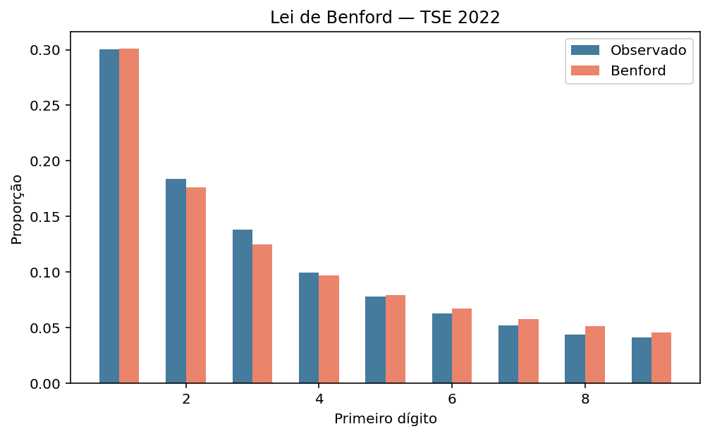

**Data de criação do código:** 12 de setembro de 2025

# Lei de Benford



Primeiro dígito dos votos nominais (TSE 2022, 2º turno presidencial) vs. expectativa de Benford.

## Como executar

Arquivo(s) principal(is): `benfords.Rmd`.

```r
# Abra o projeto no RStudio ou, para Shiny:
# setwd(".../Benfords Law")
# source("main.R")  # quando aplicável
```

## Stack

R, tidyverse, ggplot2

## Estrutura

- Código e notebooks na raiz ou subpastas do diretório do projeto.
- Imagem de capa: `docs/preview.png` (gerada ou copiada de saídas do próprio trabalho).
- Credenciais/dados privados: pasta `secrets/` (ver `SECRETS.md` na raiz do workspace, se existir).

## Dados

O CSV de votação por município e zona (cerca de 4 GB) não está versionado. Fonte: [Portal de Dados Abertos do TSE — Resultados 2022](https://dadosabertos.tse.jus.br/dataset/resultados-2022). O gráfico em `docs/preview.png` foi gerado a partir dessa base.

## Licença

Uso acadêmico/pessoal. Ajuste a licença antes de publicar no GitHub.

